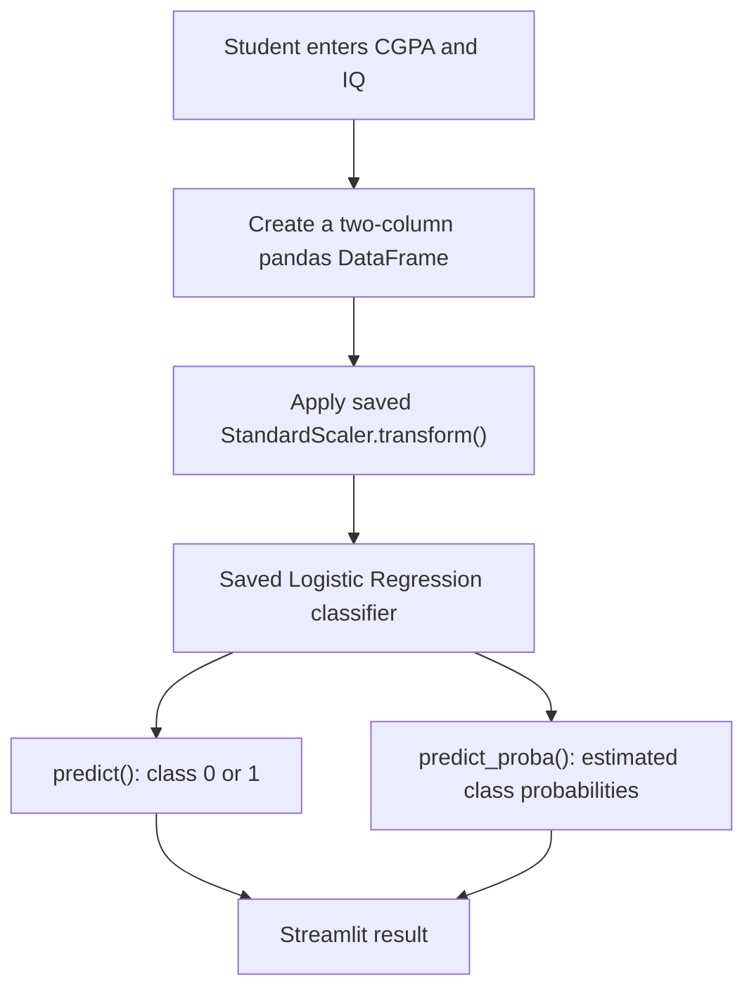

<div align="center">

# 🎓 Student Placement Predictor

### From Logistic Regression in Jupyter Notebook to an interactive Streamlit web app


**Predict a student's placement class (`0` or `1`) from CGPA and IQ, and explore the model's estimated probabilities.**

[Features](#-features) · [How it works](#-how-it-works) · [Get started](#-get-started) · [Deploy](#-deploy-on-streamlit-community-cloud) · [Limitations](#-limitations-and-responsible-use)

</div>

> [!NOTE]
> **Project status:** The application code is ready. The trained model (`placement_model.pkl`) and fitted scaler (`scaler.pkl`) must be exported from your own notebook. The public deployment URL and evaluation results are not yet provided.

## ✨ Features

- **Interactive inputs:** Adjust CGPA (0–10) and IQ (0–250), then click **Predict placement**.
- **Binary classification:** Predict **Placed (1)** or **Not placed (0)** using a trained Logistic Regression classifier.
- **Probability display:** View the model's estimated probability for each class and a progress bar.
- **Inspect preprocessing:** Expand **See data passed to the model** to compare raw inputs and standardised values.
- **Reusable model:** Loads the trained classifier and `StandardScaler` from saved `.pkl` files.
- **Simple deployment:** Designed for local use and Streamlit Community Cloud.

## 🧭 How it works



| Component | Purpose |
| --- | --- |
| `cgpa`, `iq` | The two input features |
| `StandardScaler` | Applies **training-set** mean and standard deviation to new inputs |
| `LogisticRegression` | Learns a linear decision boundary for the two placement classes |
| `predict()` | Produces the predicted class |
| `predict_proba()` | Produces estimated class probabilities |

**Important:** Fit the scaler on the **training features only**. Do **not** scale `placement`, which contains the labels `0` and `1`. Never fit a new scaler on a visitor's inputs.

## 🗂️ Project structure

```text
student-placement-predictor/
├── app.py                 # Streamlit interface and inference
├── requirements.txt       # Python dependencies
├── README.md              # Project documentation
├── .gitignore             # Files Git should exclude
├── placement_model.pkl    # Your exported, fitted classifier (add this)
└── scaler.pkl             # Your exported, fitted scaler (add this)
```

The two `.pkl` files are intentionally **not** provided with this template: they must contain the actual objects you trained.

## 🚀 Get started

### 1. Export the model and scaler from Jupyter

After running your notebook in the correct order, make sure:

- `X_train` contains the original DataFrame columns `['cgpa', 'iq']`.
- `scaler` is fitted on `X_train`.
- `clf` is trained using `scaler.transform(X_train)` and `y_train`.

Then run:

```python
import pickle
import os

# Run after fitting the scaler and training clf on scaled inputs
with open("placement_model.pkl", "wb") as f:
    pickle.dump(clf, f)

with open("scaler.pkl", "wb") as f:
    pickle.dump(scaler, f)

print("Saved in:", os.getcwd())
```

Copy both saved files next to `app.py`. **Do not export a separately fitted scaler or a model trained on unscaled inputs.**

### 2. Install dependencies

Open **Anaconda Prompt** on Windows:

```powershell
conda activate ml_env
cd "C:\path\to\student-placement-predictor"
python -m pip install -r requirements.txt
```

> [!TIP]
> Replace the example path with your actual extracted project folder. To check the environment that trained your model, run `python -m pip show scikit-learn`. For deployment, pin the matching scikit-learn version in `requirements.txt` rather than relying on a broad version range.

### 3. Start the website

```powershell
python -m streamlit run app.py
```

Visit **http://localhost:8501** if the browser doesn't open automatically. Press `Ctrl+C` in Anaconda Prompt to stop the app.

### 4. Test predictions

Try sample inputs such as CGPA `7.5` and IQ `125`. The output depends on *your* trained model; no specific prediction is guaranteed.

To cross-check the exact same example in your notebook:

```python
import pandas as pd

student = pd.DataFrame([[7.5, 125]], columns=["cgpa", "iq"])
student_scaled = scaler.transform(student)

print("Predicted class:", clf.predict(student_scaled)[0])
print("Classes:", clf.classes_)
print("Probabilities:", clf.predict_proba(student_scaled)[0])
```

The website's result and the notebook's result should match when they use the same saved model and scaler.

## ☁️ Deploy on Streamlit Community Cloud

1. Create a **public** GitHub repository named `student-placement-predictor`.
2. Commit `app.py`, `requirements.txt`, `.gitignore`, `README.md`, and **your two trusted `.pkl` files**. Do not include datasets with private information, credentials, or secrets.
3. Sign in at **[Streamlit Community Cloud](https://share.streamlit.io/)** using GitHub.
4. Create an app from your repository. Select branch `main` and entrypoint `app.py`.
5. Deploy and verify the live app with the same test inputs used locally.

**Live demo:** _Add your `https://<app-name>.streamlit.app/` URL here after successful deployment._

**Repository:** [github.com/jon-mukerji/student-placement-predictor](https://github.com/jon-mukerji/student-placement-predictor) _(link becomes usable after repository creation)_.

## 📈 Model evaluation

Use your held-out test set to calculate real metrics before making any performance claims:

```python
from sklearn.metrics import accuracy_score, classification_report, confusion_matrix

predictions = clf.predict(X_test_scaled)
print("Accuracy:", accuracy_score(y_test, predictions))
print("Confusion matrix:\n", confusion_matrix(y_test, predictions))
print(classification_report(y_test, predictions, zero_division=0))
```

| Metric | Result |
| --- | --- |
| Accuracy | _Add your measured result_ |
| Precision (placed) | _Add your measured result_ |
| Recall (placed) | _Add your measured result_ |
| F1-score (placed) | _Add your measured result_ |

> [!IMPORTANT]
> If your test split contains only 10 students, these scores will be unstable. Consider additional validation and a larger dataset before drawing conclusions.

## 🛠️ Troubleshooting

<details>
<summary><strong>Missing model or scaler file</strong></summary>

Export `placement_model.pkl` and `scaler.pkl` from your notebook and place them in the same folder as `app.py`. Reload Streamlit.

</details>

<details>
<summary><strong>ModuleNotFoundError: streamlit (or another dependency)</strong></summary>

Activate `ml_env`, then run `python -m pip install -r requirements.txt` and launch with `python -m streamlit run app.py`.

</details>

<details>
<summary><strong>Feature names mismatch / suspicious predictions</strong></summary>

Confirm that the scaler was fitted on the original DataFrame with **exactly** `cgpa`, `iq` in that order, and that the classifier was trained with its transformed output. Transform each new raw input **once**.

</details>

<details>
<summary><strong>Cannot load a model on the cloud</strong></summary>

Check that both `.pkl` files are committed and that the deployment uses a compatible Python/scikit-learn environment. Pickled scikit-learn objects are not reliably portable across library versions.

</details>

## ⚠️ Limitations and responsible use

This is a **learning and portfolio demonstration**, not an admissions, recruitment, or career decision system. Placement probabilities are model estimates, not promises, and may be poorly calibrated. Results may reflect bias or limited coverage in the training data. Do not use predictions to make real decisions about people.

Only load `.pkl` files you created or trust: Python pickle deserialisation can execute arbitrary code.

## 👨‍💻 Author

**Srijan Mukherjee** · [GitHub](https://github.com/jon-mukerji)

---

<div align="center">

**Built with Python · Scikit-learn · Pandas · Streamlit**

⭐ If this project helped you learn, consider starring the repository.

</div>
